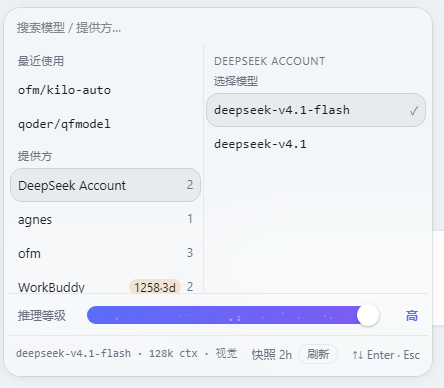

# 模型雷达（dsh-model-radar）

> 输入框下面多一颗胶囊。点开是「提供方在左、模型向右展开」的目录面板，搜索、切模型、调推理等级都在一个弹层里完成。

<p align="center">
  
</p>

> **个人自用项目。** 不是通用产品：接口随我自己需要变动，不承诺向后兼容，也不承诺响应时间。开源只为代码可读、可改、可搬零件；你要用，请自己读代码、自己承担后果。

## 为什么还要一个模型选择器

Harness 自带的模型选择器是一个下拉。模型一多就得滚，而且它只回答「选哪个」，不回答另外三件事：哪些提供方现在可用、这个渠道还剩多少额度、我最近点过什么。

雷达把这几个问题摊在一屏里：左边提供方和它下面的模型数量，右边是选中提供方的全部模型，顶上一行搜索，最近用过的排在最前。

它**不接管**官方那个选择器——官方那颗按钮始终在座、始终可用，雷达只是同一行里多出来的一颗胶囊，两套共存。

## 它做什么

- **按提供方分组的目录**：搜索、浏览、点一行就切换。
- **最近使用**：从会话事件里折叠得出，不额外存盘。
- **推理等级滑条**：松手即生效（乐观更新），不等宿主回话。
- **积分到期徽标**（可选）：提供方行上显示这个渠道还有多少分快过期。数据来自外部脚本写入的本地快照，没有该文件时徽标区为空，其余功能完全不受影响。

## 安装

需要 DeepSeek Harness。版本区间看 `package.json` 的 `engines.dsh`，不满足时宿主会直接拦下并说明原因。

**方式一：直接从 GitHub 装**（不用先克隆，锁当时 HEAD commit）

```powershell
plugin_manager install_bundle(target='github:Gumife/dsh-model-radar')
```

**方式二：克隆到本地再指向目录**（要改代码用这个，改完重启即生效）

```powershell
git clone https://github.com/Gumife/dsh-model-radar.git
plugin_manager install_bundle(target='<克隆路径>/dsh-model-radar')
```

不要手改 profile 的 `package.json` / `cordis.patch.yml`，也不要在 profile 目录跑 pnpm；卸载走 `remove_bundle`。

<details>
<summary><strong>为什么声明了两个挂载槽位</strong></summary>

`cordis.patch.yml` 同时挂 `conversation.composer.dock` 与 `conversation.hero.options`。宿主在**新会话空态**渲染的是 hero 行而不是 dock 行，只挂一个会有一段时间看不见入口。两槽互斥，不会同时出现。

</details>

**改完 `client.js` 或 `index.js` 必须整进程重启宿主，刷新页面不够。**

## 用法

点胶囊 → 搜索或按提供方浏览 → 点一行切换模型 → 滑条调推理等级。

## 结构

| 文件 | 作用 |
| --- | --- |
| `index.js` | Host 半，注册 `POST /radar/api`，五个命令：`catalog` / `modelInfo` / `select` / `credits` / `creditsRefresh` |
| `client.js` | Client 半，两个槽位各挂一颗胶囊与各自弹层 |
| `cordis.patch.yml` | 挂载声明（`name` 必须等于包名） |
| `verify-host.mjs` | Host 半契约测试，桩驱动 |
| `verify-client.mjs` | Client 半契约测试，**真实执行** factory |
| `tests/*.mjs` | 纯函数单测（格式化 / 目录缓存 / 到期文案） |
| `build-preview.mjs` | 用真实组件渲染 `preview.html` |

数据全部来自宿主 API（`llm.listProviders` / `llm.listModels` / `llm.resolveModelInfo` / `sessionController.selectModel`）。**零第三方依赖**，不 import 任何 `dsh-connect-*`，所以别的插件升降级影响不到它。

## 积分到期徽标（可选）

徽标挂在**提供方行**上，数据来自 `~/.dsh/credits-expiry/latest.json`，由外部脚本写入，**脚本不在本仓库内**。

- 窗口 3 天。三种形态：`1258·3d`（窗口内将过期）、`!N`（已过期但仍有余额）、`?N`（账号读不到）。干净渠道不显示 0。
- 页脚那个「快照 Nh」不是装饰——它是这组数字的可信边界。

## 验证

```powershell
node --check index.js ; node --check client.js
node tests/fmt.mjs && node tests/catalog.mjs && node tests/credits.mjs
node verify-client.mjs
node verify-host.mjs
```

全部桩驱动，不需要登录态，也不碰真实 profile。

`verify-client.mjs` 会**真实执行** factory——`node --check` 抓不到加载期错误（比如 CSS 模板里混进反引号），靠它抓。

`node build-preview.mjs` 生成 `preview.html`：用组件真实输出渲染，但毕竟不是宿主页面，dock 行里的邻居与主题变量还得进 GUI 看一眼。
